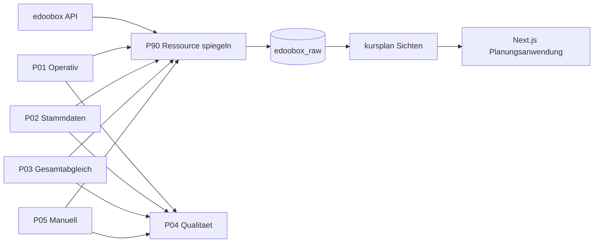

# Projektstand — Kursplan-App

**Dokumenttyp:** Projektstand-Dokumentation (laufend gepflegt)
**Stand:** 13. Oktober 2026
**Basis:** [`Statusbericht Datenbank und Trainer-Zuweisung.md`](Statusbericht Datenbank und Trainer-Zuweisung.md), [`Spezifikation produktive n8n-Workflows P90-P05.md`](Spezifikation produktive n8n-Workflows P90-P05.md), [`Abgleichbericht P01-P05.md`](Abgleichbericht P01-P05.md), [`End-to-End-Abgleichbericht.md`](End-to-End-Abgleichbericht.md), [`Lastenheft Kursplan v1.6.md`](Lastenheft Kursplan v1.6.md)

---

## 1. Überblick

Das Projekt baut eine **Kursplanungs-Anwendung** auf, die Kursangebote, Termine, Trainer und Erlöskennzahlen (DB I) aus **edoobox** in eine lokale PostgreSQL-Datenbank spiegelt und über eine **Next.js-Webanwendung** planbar macht.

**Leitprinzipien (verbindlich):**

- **Schema-Trennung:** `edoobox_raw` = unveränderter Spiegel von edoobox (Single Source of Truth); `public` = lokale App-Daten, Optionen und manuelle Zuweisungen.
- **Strikte Soft-Delete-Regel:** Keine physischen Löschungen in `edoobox_raw`; entfallene Datensätze werden ausschließlich per `is_deleted = true` markiert.
- **Schutz historischer Bestände:** Zeitfenster-Syncs dürfen Datensätze außerhalb des Fensters weder modifizieren noch als gelöscht markieren.
- **Vollständiges Ersetzen von Payloads:** Bei Konflikten wird das JSON-Feld vollständig ersetzt (`payload = EXCLUDED.payload`), kein JSON-Merge.
- **Datensparsamkeit:** Personenbezogene Felder (Name, Anschrift, E-Mail, IP) werden nicht gespiegelt; Besitzer nur als `md5`-Streuwert (`user_ref`).

---

## 2. Systemarchitektur

| Komponente | Details |
| --- | --- |
| **Host** | Hetzner (`46.62.206.211`) |
| **Datenbank** | PostgreSQL, Container `kursplan-db`, Datenbank `kursplan`, Port 5433 (lokal) / 5432 (im Docker-Netz) |
| **Automatisierung** | n8n, Container `n8n-frank` |
| **Netzwerk** | Docker-Bridge `kursplan_net` (DNS-Auflösung `kursplan-db` funktioniert) |
| **DB-Benutzer** | `kursplan_user` (Admin/Owner, DDL) · `n8n_writer` (DML auf `public`, Leserechte auf `edoobox_raw`) |

### 2.1 Datenfluss

---

## 3. Datenbank-Architektur

### 3.1 Schema `edoobox_raw` (Spiegelung)

| Tabelle | Inhalt |
| --- | --- |
| `offer` | Seminare (`offer_id`, `name`, `status`, `payload` jsonb) |
| `offer_date` | Kurstermine (`date_id` text, `offer_id`, `date_start`, `date_end`, `is_deleted`) |
| `date_leader` | Trainerzuordnung n:m (`date_id`, `admin_id`) |
| `trainer_admin` | Edoobox-Trainerliste (`admin_id`, `shortcut`, `permission`, `is_active`) |
| `booking` | Buchungen (ohne Personendaten, `user_ref` als md5) |
| `booking_position` | Buchungspositionen (`UNIQUE (booking_id, pricecategory_id)`) |
| `booking_transaction` | Transaktionen mit Buchungsbezug |
| `invoice`, `invoice_item`, `invoice_line`, `invoice_payment`, `invoice_receipt` | Rechnungskopf, Posten, Zeilen, Zahlungen, Belege |
| `user_account` | Benutzer nur als `user_ref = md5(edoobox-Kennung)` |
| `transaction_full` | Vollständige Transaktionsressource (O-9) |
| `sync_run`, `sync_run_resource` | Laufprotokoll der Abgleiche |

### 3.2 Schema `public` (Applikation)

| Tabelle | Inhalt |
| --- | --- |
| `trainer` | Stammdaten (`id` SERIAL PK, `vorname`, `nachname`, `kuerzel` UNIQUE, `edoobox_admin_id` UNIQUE, `farbe`, `is_active`) |
| `trainer_verfuegbarkeit` | Kalender-/Slot-Verfügbarkeiten (FK → `trainer(id)` ON DELETE CASCADE) |
| `trainer_zuweisung` | Zuweisung Trainer ↔ Termin (`date_id` text, `status`, `notiz`; `UNIQUE (date_id, trainer_id)`) |
| `termin_optionen`, `termin_reservierung` | Optionen und Reservierungen |

### 3.3 Auswertungssichten

Die Planungsanwendung liest ausschließlich über Sichten (Schema `kursplan`, z. B. `v_termin_db1`). Diese aggregieren Erlös, Trainerkosten, Plattformkosten, direkte Kosten und **DB I** ab 2023.

---

## 4. n8n-Workflow-Kette P90–P05

### 4.1 Inventar und Aktivierungszustand

| Kennung | Name | n8n-ID | Knoten | Aktiv | Validierung |
|---|---|---|---|---:|---|---|
| **P90** | Ressourcen-Unterworkflow | `XgBiU2H8GgavCbe1` | 10 | ✅ | 0 Fehler |
| **P03** | Wöchentlicher Gesamt- und Löschabgleich | `Rg3rB0RD8ISL0U6Y` | 16 | ✅ | 0 Fehler |
| **P01** | Operative Ressourcen synchronisieren | `eIyJaeTeqWidRYDu` | 11 | ✅ | 0 Fehler |
| **P02** | Stamm- und Referenzdaten synchronisieren | `IrS9JcdrOK1MXUO5` | 9 | ✅ | 0 Fehler |
| **P04** | Qualitätskontrolle und Benachrichtigung | `dnf6LyuhQawESBX0` | 6 | ✅ | 0 Fehler |
| **P05** | Manueller Wiederanlauf | `DRcCDA7Dp02NYryE` | 9 | ⏸ inaktiv | 0 Fehler |
| **S63** | Pflegeschritt Kostenkonfiguration | `6OouANAXpN1HR9tl` | — | ✅ | idempotent |
| **B01** | Kurstransfer edoobox (Batch) | `4wdC1BJi6gyaZQel` | 13 | ✅ | — |

> **Namenskonvention:** `B` steht für **Batch-Workflows**. Der Workflow `Kurstransfer_edoobox` heißt seit dem 13.10.2026 `B01_Kurstransfer_edoobox`.

### 4.2 Rollen

| Kennung | Rolle | Auslöser | Umfang |
| --- | --- | --- | --- |
| **P90** | Gemeinsamer Ressourcen-Unterworkflow | nur via P01–P05 | Auth, Seitenabruf, Normalisierung, Hashvergleich, UPSERT, Lösch-Markierung, Laufprotokoll |
| **P03** | Gesamt- und Löschabgleich | wöchentlich nachts | alle 12 Ressourcen, `track_deletions = true` |
| **P01** | Operative Ressourcen | `*/15 8-23 * * 1-5` | 7 Ressourcen, `track_deletions = false` |
| **P02** | Stamm-/Referenzdaten | täglich 02:00 | 5 Ressourcen, `track_deletions = false` |
| **P04** | Qualitätskontrolle | täglich 04:30 + nach P01–P03/P05 | Laufalter, Vollständigkeit, Beziehungen, DB-I-Kennzahlen |
| **P05** | Manueller Wiederanlauf | manuell | Ressource/`alle`, `normal`/`voll` |

### 4.3 Kernmechanik P90

- **Paginierung:** `limit[start]`/`limit[reply]`, geprüfter Höchstwert 2000, Abbruch bei wiederholter Folgeseiten-Kennung (kein Endlos-Loop).
- **Hash:** `md5(concat_ws('|', …))` über fachlich relevante Felder; `last_changed_at` nur bei Hash-Änderung.
- **UPSERT:** `INSERT … ON CONFLICT (pk) DO UPDATE`, parametrisiert; `payload = EXCLUDED.payload`.
- **Lösch-Markierung:** nur im Vollabgleich-Modus (`is_deleted = true`, kein physisches Löschen).
- **Fachstatus Buchungen:** abgeleitet aus booleschen Feldern (`waiting_list`/`canceled`), da `/booking/list` kein `status`-Feld liefert.
- **Datenschutz:** `edo_users` → nur `user_ref = md5(owner)` in `user_account`.

### 4.4 Behobene Laufzeitdefekte (Stand 20.09.2026)

| Defekt | Ursache | Behebung |
| --- | --- | --- |
| `run_id` Typfehler | PostgreSQL liefert bigint als String | P90-Eingang `run_id` auf `any`, Normalisierung per `Number(...)` |
| `records_seen is ambiguous` | mehrdeutige RETURNING-Spalten in Aggregations-CTE | Spalten mit `sync_run.` qualifiziert (P01/P02/P03) |
| `column o.owner does not exist` | `hashFelder: ['owner']` statt `['user_ref']` | Fix in aktiver P90-Konfiguration **und** [`p90_node_konfig.js`](p90_node_konfig.js:297) |
| Nettoerlös = 0,00 € | `booking.status` war NULL (Feld existiert nicht in `/booking/list`) | Fachstatus aus `waiting_list`/`canceled` abgeleitet |

---

## 5. Next.js-Anwendung (`app/`)

**Stack:** Next.js 16.3.5 · React 19.2.8 · TypeScript 5 · Tailwind CSS 4 · `pg` 8.23

### 5.1 Seiten

| Route | Zweck |
| --- | --- |
| `/` | Startseite |
| `/trainer` | Trainerübersicht |
| `/trainer/verfuegbarkeit` | Verfügbarkeitsverwaltung |
| `/trainer/zeitplan` | Zeitplan |

### 5.2 API-Routen

| Route | Zweck |
| --- | --- |
| `/api/admin/clean-test-data` | Testdaten-Bereinigung |
| `/api/edoobox/vorlagen` | edoobox-Vorlagen |
| `/api/reservierung` (+ `/umwandeln`) | Reservierungen und Umwandlung |
| `/api/sync/p90` | P90-Sync-Anbindung |
| `/api/trainer` | Trainer-Stammdaten |
| `/api/trainer/zeitplan` (+ `/status`) | Zeitplan und Status |
| `/api/verfuegbarkeit` | Verfügbarkeiten |
| `/api/zuweisung` | Trainer-Zuweisungen |

### 5.3 Bibliotheken (`app/src/lib/`)

`db.ts` (PostgreSQL-Verbindung) · `feiertage.ts` · `honorar.ts` · `umwandlung.ts` · `verfuegbarkeit.ts`

### 5.4 Kurstransfer (statisch, `app/public/Kurstransfer/`)

Statische Import-/Planungshilfen (Excel-Import, Kategorien, Python-Skripte) für die Jahres-Kursplanung.

---

## 6. Skripte und Migrationen (`scripts/`, Projektstamm)

- **Migrationen (SQL):** `trainer_zuweisung_*`, `trainer_saetze`, `trainer_kosten`, `trainer_halbtagessatz_reduziert`, `termin_reservierung_*`, `trainer_honorar_90min_migration.sql`
- **Pflege-/Verifikationsskripte (CJS):** `import_trainer_kosten.cjs`, `check_trainer.cjs`, `cleanup_ghost_trainer.cjs`, `cleanup_trainer_zuweisung_alt.cjs`, `diagnose_*.cjs`, `verify_*.cjs` (Verfügbarkeit, Schließung, Last-Minute, Hervorhebung, Status)
- **n8n-Referenzdateien:** `p90_node_konfig.js`, `p90_node_holen.js`, `p90_node_fehlertext.js`, `p90_node_zaehlwerte.js`, `P90_Ressourcen_Konfiguration.sql`, `p90_build.ps1`, `p90_verify.ps1`
- **Workflow-Exporte:** `n8n/P96_Create_edoobox_Offer_from_Reservation.json`, `n8n/P06_trainer_adhoc_sync.json`

---

## 7. Datenstand und Kennzahlen (DB I, ab 2023)

Referenzmarken aus der Spezifikation; Ist-Stand nach S63 (20.09.2026):

| Kennzahl | Referenz | Ist | Bewertung |
| --- | ---: | ---: | --- |
| berechenbare Angebote | 1.696 | 1.697 | 🟠 +1 |
| produktiver Nettoerlös | 430.049,62 € | 428.064,24 € | 🟢 −0,46 % |
| Trainerkosten | 227.452,00 € | 229.982,00 € | 🟢 +1,11 % |
| Plattformkosten | 11.715,00 € | 11.835,00 € | 🟢 +1,02 % |
| direkte Kosten | 239.167,00 € | 241.817,00 € | 🟢 +1,11 % |
| **DB I** | **190.882,62 €** | **186.247,24 €** | 🟢 −2,43 % |
| offene Kostenkonfigurationen | 0 | **0** | ✅ |

**Bekannte Historienlücken (P04-Warnungen, bewusst nicht „repariert“):**

- 87 Buchungen ohne Angebot
- 10 Trainerzuordnungen ohne Trainerprofil (historische Admin-Kennungen, O-10)
- 4 Anwesenheiten ohne Termin

---

## 8. Offene Punkte

| Kennung | Punkt | Status |
| --- | --- | --- |
| **O-7** | Benachrichtigungskanal für P04 (E-Mail) | offen — Meldung derzeit nur über `sync_run.status='fehler'`/`error_text` |
| **O-8** | Ableitung `booking_position`/`booking_transaction` aus `booking.list` | **fachlich geschlossen** (20.09.2026); Rest: Pflege offener Kostenkonfigurationen via S63 |
| **O-9** | Vollständige Transaktionsressource | abgedeckt über `transaction_full`; Buchungsbezug zusätzlich in `booking_transaction` |
| **O-10** | Historische Platzhalterprofile | bewusst **nicht** erfundene Profile; FK-Lücken bleiben P04-Warnung; neue Trainer/Kurscodes werden vollständig angelegt (S63) |
| **P05** | Manueller Wiederanlauf | angelegt und validiert, noch **inaktiv** (planmäßig) |

---

## 9. Nächste Schritte (Empfehlung)

1. **P05** aktivieren (manueller Wiederanlauf für Wartung/Fehlerbehebung).
2. **O-7** klären: E-Mail-Kanal für P04-Benachrichtigungen einrichten.
3. **P04-Warnungen** bewerten: 87 Buchungen ohne Angebot, 10 Trainer ohne Profil, 4 Anwesenheiten ohne Termin (Historienbereinigung oder dauerhafte Toleranz).
4. **App-Ausbau:** API-Routen und Frontend-Komponenten für Trainerauswahl, Zeitplan und Verfügbarkeit an die produktiven Sichten anbinden.
5. **Regelmäßiger Betrieb:** P03 wöchentlich, P01/P02 im Takt, S63 nach P01/P03 als Pflegeschritt; P04-Kennzahlen gegen die Kontrollmarken überwachen.

---

## 10. Quellenverzeichnis

- [`Lastenheft Kursplan v1.6.md`](Lastenheft Kursplan v1.6.md) — Anforderungen E-24a, E-27 bis E-34, Abnahmefälle AK-29 bis AK-40
- [`Spezifikation produktive n8n-Workflows P90-P05.md`](Spezifikation produktive n8n-Workflows P90-P05.md) — Zielarchitektur P90–P05, Feld-Mappings, offene Punkte O-1 bis O-10
- [`Abgleichbericht P01-P05.md`](Abgleichbericht P01-P05.md) — Erstellung/Validierung P01–P05, P03-Ergänzung
- [`Abgleichbericht P90-P03.md`](Abgleichbericht P90-P03.md) — P90/P03-Abgleich und M1–M5-Abweichungen
- [`End-to-End-Abgleichbericht.md`](End-to-End-Abgleichbericht.md) — Live-Abgleich, Laufzeitdefekte D-1 bis D-3, O-8-Schließung, S63
- [`Statusbericht Datenbank und Trainer-Zuweisung.md`](Statusbericht Datenbank und Trainer-Zuweisung.md) — Systemarchitektur, DB-Schemata
- [`Abschlussbericht zur DB-I-Auswertung.md`](Abschlussbericht zur DB-I-Auswertung.md) — DB-I-Auswertung
- [`edoobox_spiegelung_schema.sql`](edoobox_spiegelung_schema.sql), [`edoobox-Spiegelung  Sichten.sql`](edoobox-Spiegelung  Sichten.sql), [`edoobox-Spiegelung  Rechnungstabellen.sql`](edoobox-Spiegelung  Rechnungstabellen.sql) — DDL der Spiegelung
- [`P90_Ressourcen_Konfiguration.sql`](P90_Ressourcen_Konfiguration.sql), [`p90_node_konfig.js`](p90_node_konfig.js), [`p90_node_holen.js`](p90_node_holen.js) — kanonische P90-Konfiguration
